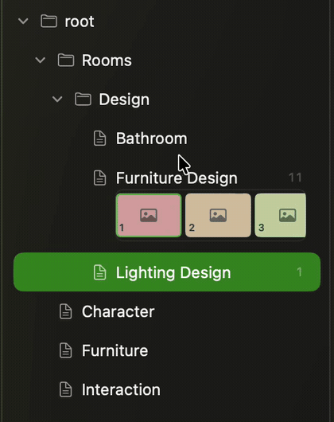

# Cross-Project Components

A single Swift Package repository for reusable native UI components, split by platform so one platform's implementation details do not leak into the other.

## macOS — `CrossProjectComponents`

Import `CrossProjectComponents` for the native macOS components:

### TreeView


An infinitely nestable outline based on AppKit's `NSOutlineView`. See [`API.md`](Components/macOS/TreeView/API.md) for the model and callback contract.

### FilmstripScrubber


A draggable filmstrip scrubber for image collections. Uses AppKit image loading and is macOS-only.

## iOS — `CrossProjectComponentsIOS`

Import `CrossProjectComponentsIOS` for the reusable SwiftUI components extracted from the ZPing app project:

### MessageComposer
A voice/text chat composer based on ZPing's `InputSection`. Supports configurable styling, text and voice modes, recording/transcribing states, waveform levels, attachment/send/call callbacks, an action-press callback, and bar-height measurement. The host app owns microphone permissions and the audio/transcription engine.

- Source reference: `ZPing/src/ui/composed/InputSection.swift` and the `screen_chat` input controls.
- [Component API and example](Components/iOS/MessageComposer/README.md)
- Shared color tokens: [`Components/iOS/Resources/design-tokens.json`](Components/iOS/Resources/design-tokens.json), exposed to consumers as `ComponentDesignPalette.warmEmber`. Component and preview defaults reference this JSON resource rather than defining colors in Swift.

### SwipeBack
The leading-edge swipe-back modifier extracted from ZPing's actual chat/file overlay implementation. It includes direction arbitration, scroll coordination, distance/velocity thresholds, spring settling, optional haptic override, and a presentation binding.

- Source reference: `ZPing/src/ui/components/gestures/screen_chat/SwipeBackModifier.swift`.
- [Component API and example](Components/iOS/SwipeBack/README.md)

## Platform and build

- macOS 13+: `CrossProjectComponents`
- iOS 17+: `CrossProjectComponentsIOS`
- Swift tools: 5.9+

Build each product for its destination platform:

```sh
swift build --product CrossProjectComponents --triple arm64-apple-macosx13.0
swift build --product CrossProjectComponentsIOS --triple arm64-apple-ios17.0
```

The two products are separate build targets. The macOS tree and filmstrip sources stay under `Components/macOS`; the extracted iOS composer and swipe-back modifier stay under `Components/iOS`.
